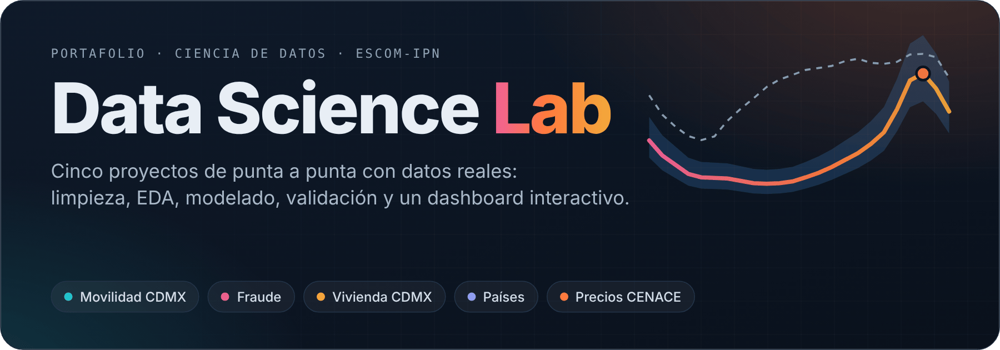
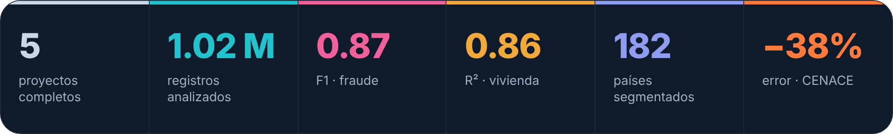
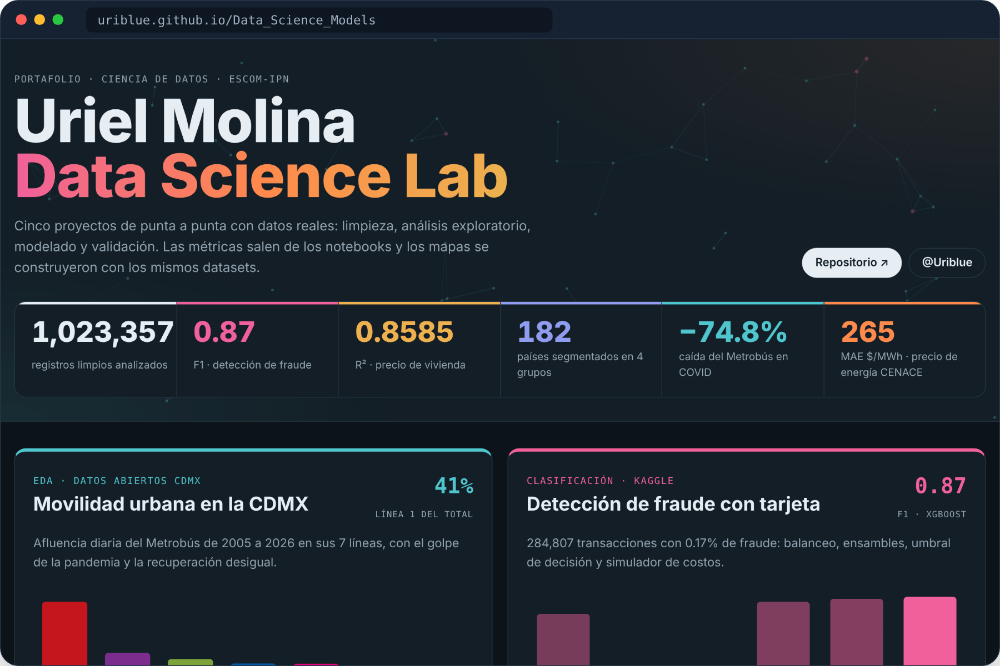
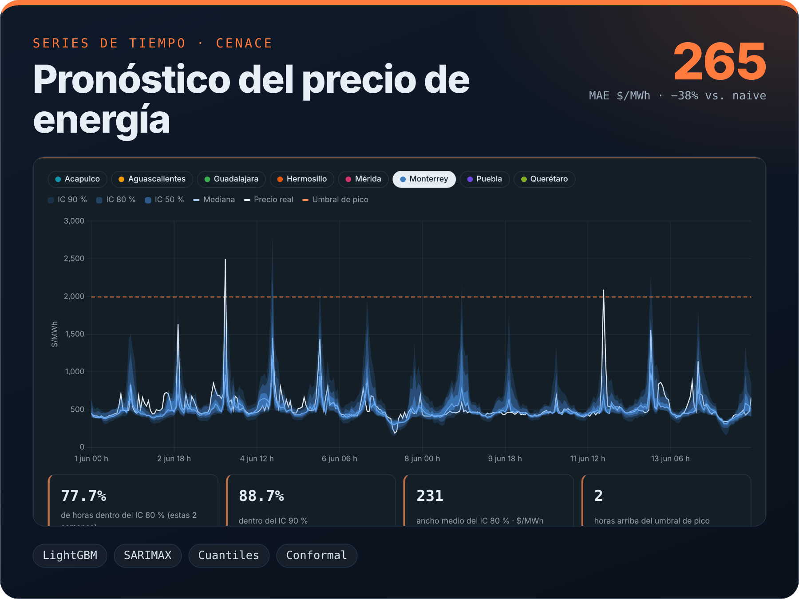
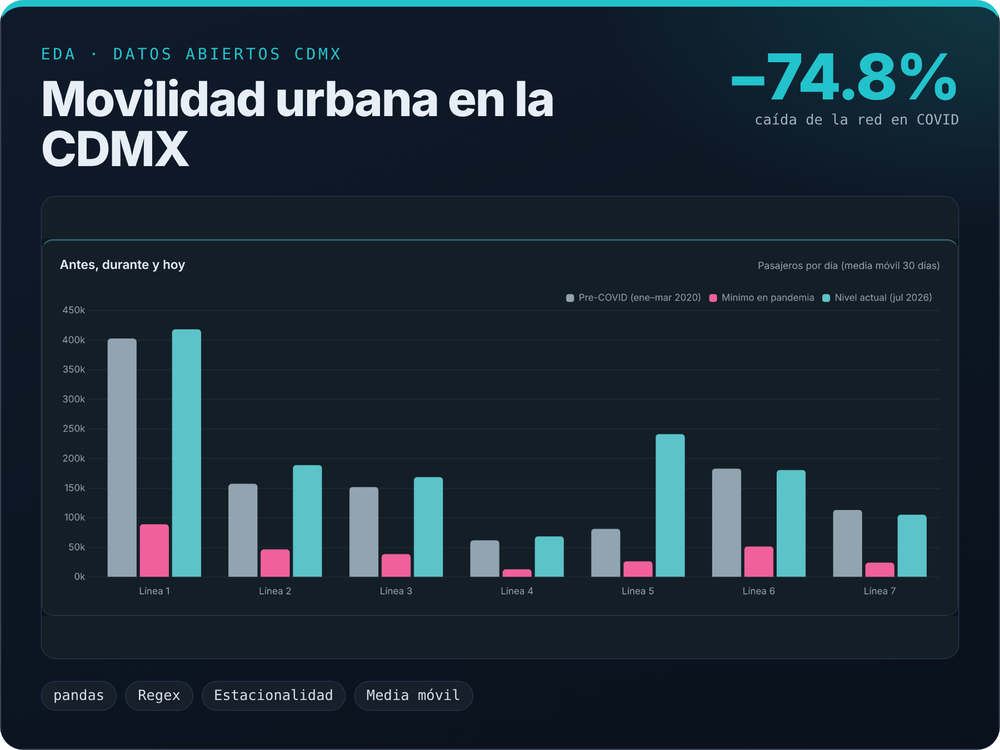
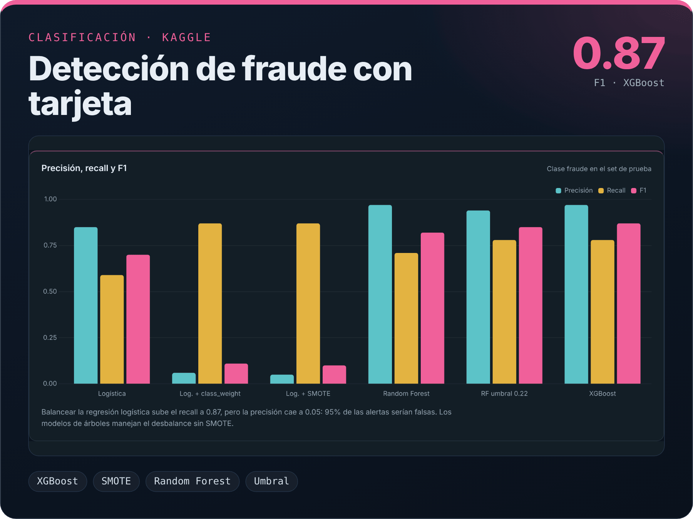
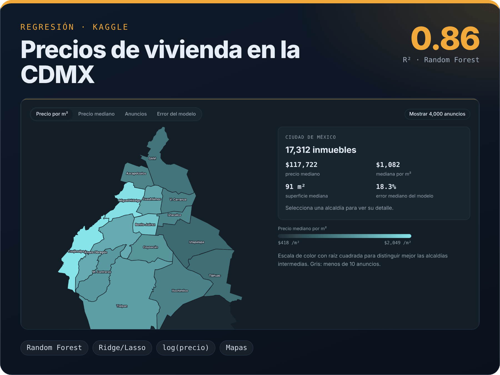
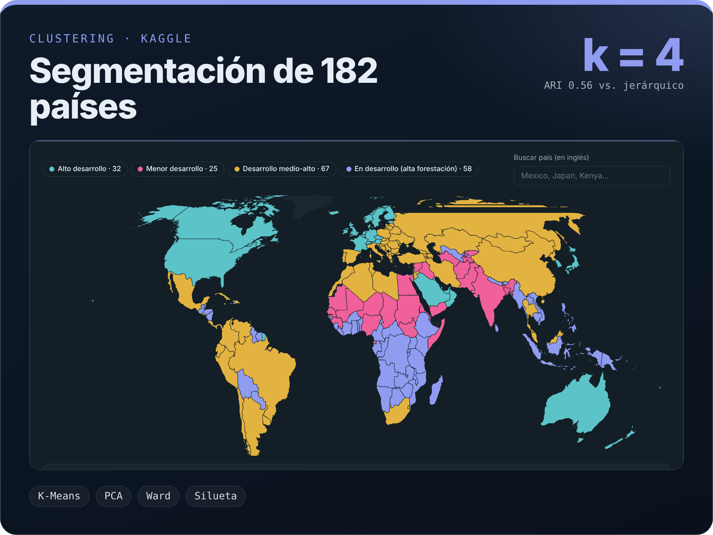

<div align="center">

<a href="https://uriblue.github.io/Data_Science_Models/"></a>

<br>

<a href="https://uriblue.github.io/Data_Science_Models/"></a>


<a href="#español"><b>Español</b></a> · <a href="#english"><b>English</b></a>

</div>



## Español

Soy **Uriel Molina**, estudiante de **Ciencia de Datos en ESCOM-IPN** (Ciudad de México). Este repositorio reúne cinco proyectos completos con datos reales. Cada uno responde una pregunta concreta y recorre el flujo completo: obtener y limpiar los datos, explorarlos, modelar, validar y comunicar los resultados.

### Dashboard interactivo

Todos los resultados están en una sola página con mapas, gráficas interactivas y las figuras de los notebooks.

<a href="https://uriblue.github.io/Data_Science_Models/"></a>

<p align="center"><a href="https://uriblue.github.io/Data_Science_Models/"><b>Abrir el dashboard →</b></a></p>

### Proyectos

<a href="https://uriblue.github.io/Data_Science_Models/#cenace"></a>

**Pronóstico probabilístico del precio de energía (CENACE).** ¿Qué tan bien se puede anticipar el precio del Mercado del Día en Adelanto y qué tan confiables son sus intervalos? Comparo naive, SARIMAX por hora y LightGBM global sobre 8 zonas de carga (2017–2026). Después agrego regresión cuantílica con calibración conformal y una alerta de picos de precio.
<br>[Notebooks](Data%20Science%20Proyects/CENACE_PEND) · [README del proyecto](Data%20Science%20Proyects/CENACE_PEND/README.md) · [Dashboard](https://uriblue.github.io/Data_Science_Models/#cenace)

<table>
<tr>
<td width="50%" valign="top">
<a href="https://uriblue.github.io/Data_Science_Models/#metrobus"></a>
<b>Movilidad urbana en la CDMX.</b> Afluencia diaria del Metrobús de 2005 a 2026: tendencia, estacionalidad, el golpe de la pandemia y una recuperación muy desigual entre líneas.
<br><a href="Data%20Science%20Proyects/metrobus_afluencia/main-code.ipynb">Notebook</a> · <a href="https://uriblue.github.io/Data_Science_Models/#metrobus">Dashboard</a>
</td>
<td width="50%" valign="top">
<a href="https://uriblue.github.io/Data_Science_Models/#fraude"></a>
<b>Detección de fraude con tarjeta.</b> 284,807 transacciones con 0.17 % de fraude. Balanceo, ensambles y ajuste del umbral de decisión, con un simulador de costos.
<br><a href="Data%20Science%20Proyects/Classificatio_proyect_fraude_transacciones/Deteccion_de_fraudes.ipynb">Notebook</a> · <a href="https://uriblue.github.io/Data_Science_Models/#fraude">Dashboard</a>
</td>
</tr>
<tr>
<td width="50%" valign="top">
<a href="https://uriblue.github.io/Data_Science_Models/#vivienda"></a>
<b>Precios de vivienda en la CDMX.</b> 17,312 inmuebles, mapa por alcaldía y cinco modelos para estimar el precio de venta a partir de tamaño, ubicación y tipo.
<br><a href="Data%20Science%20Proyects/Regression_proyect/City.ipynb">Notebook</a> · <a href="https://uriblue.github.io/Data_Science_Models/#vivienda">Dashboard</a>
</td>
<td width="50%" valign="top">
<a href="https://uriblue.github.io/Data_Science_Models/#paises"></a>
<b>Segmentación socioeconómica de países.</b> 182 países agrupados en 4 perfiles de desarrollo con K-Means, visualizados con PCA y validados con clustering jerárquico.
<br><a href="Data%20Science%20Proyects/%28Clustering%29/world_2023.ipynb">Notebook</a> · <a href="https://uriblue.github.io/Data_Science_Models/#paises">Dashboard</a>
</td>
</tr>
</table>

### Resumen de resultados

| Proyecto | Tipo | Datos | Mejor modelo | Resultado |
|---|---|---|---|---|
| Precio de energía · CENACE | Series de tiempo | 685,632 horas-zona · CENACE | LightGBM + conformal | **MAE 265 $/MWh** (−38 % vs. naive) · cobertura 80 % → **78.2 %** · **74 %** de picos detectados |
| Movilidad CDMX | EDA | 36,505 días-línea · Datos Abiertos CDMX | — | Línea 1 = **41 %** de la afluencia · caída de **74.8 %** en COVID |
| Fraude con tarjeta | Clasificación | 284,807 transacciones · Kaggle | XGBoost | **F1 0.87** · **AP 0.825** · 2 falsas alarmas en 56,651 |
| Vivienda CDMX | Regresión | 17,312 inmuebles · Kaggle | Random Forest | **R² 0.8585** · MAE **$74,688 USD** (−52 % vs. lineal) |
| Países | Clustering | 182 países · Kaggle | K-Means (k = 4) | ARI **0.56** vs. jerárquico · 51.5 % de varianza en 2 PC |

### Cómo trabajo

```
Pregunta  →  Datos y limpieza  →  Análisis exploratorio  →  Modelado  →  Validación  →  Comunicación
```

- **Sin fuga de información:** escalado, balanceo y rezagos se ajustan solo con datos de entrenamiento.
- **Siempre contra una línea base:** cada modelo se compara con uno simple para medir cuánto aporta.
- **Métricas que corresponden al problema:** F1 y AP para clases desbalanceadas, MAE en unidades reales, cobertura y pinball para intervalos.
- **Decisiones documentadas:** cada notebook explica por qué se limpió, transformó o descartó algo.

### Herramientas

<p>


</p>

### Estructura

```
Data_Science_Models/
├── Data Science Proyects/
│   ├── CENACE_PEND/                                 # series de tiempo + app de Streamlit
│   ├── metrobus_afluencia/main-code.ipynb           # EDA
│   ├── Classificatio_proyect_fraude_transacciones/  # clasificación
│   ├── Regression_proyect/City.ipynb                # regresión
│   └── (Clustering)/world_2023.ipynb                # clustering
├── docs/index.html                                  # dashboard (GitHub Pages)
└── assets/                                          # imágenes de este README
```

### Cómo correrlo

```bash
git clone https://github.com/Uriblue/Data_Science_Models.git
cd Data_Science_Models
pip install pandas numpy scipy scikit-learn xgboost lightgbm \
            statsmodels imbalanced-learn matplotlib seaborn plotly jupyter
jupyter lab
```

El proyecto de CENACE tiene su propio [`requirements.txt`](Data%20Science%20Proyects/CENACE_PEND/requirements.txt) y su guía para descargar los datos del CENACE y correr el dashboard de Streamlit.

### Contacto

<a href="mailto:urisour009@gmail.com"></a>
<a href="https://github.com/Uriblue"></a>

<p align="right"><a href="#español">↑ Volver arriba</a></p>

---

## English

I'm **Uriel Molina**, a **Data Science student at ESCOM-IPN** (Mexico City). This repository brings together five end-to-end projects built on real-world data. Each one answers a concrete question and covers the full workflow: data collection and cleaning, exploration, modeling, validation and communicating results.

**[Open the interactive dashboard →](https://uriblue.github.io/Data_Science_Models/)**

| Project | Type | Data | Best model | Result |
|---|---|---|---|---|
| [Electricity price forecast · CENACE](Data%20Science%20Proyects/CENACE_PEND) | Time series · probabilistic forecasting | 685,632 zone-hours, 8 load zones 2017–2026 · CENACE | LightGBM + conformal calibration | **MAE 265 $/MWh** (−38 % vs. naive) · 80 % interval coverage **78.2 %** · **74 %** of price spikes caught |
| [Urban mobility in Mexico City](Data%20Science%20Proyects/metrobus_afluencia/main-code.ipynb) | EDA | Daily Metrobús ridership 2005–2026 · CDMX Open Data | — | Line 1 = **41 %** of ridership · **74.8 %** drop during COVID |
| [Credit card fraud detection](Data%20Science%20Proyects/Classificatio_proyect_fraude_transacciones/Deteccion_de_fraudes.ipynb) | Classification | 284,807 transactions, 0.17 % fraud · Kaggle | XGBoost | **F1 0.87** · **AP 0.825** |
| [Mexico City housing prices](Data%20Science%20Proyects/Regression_proyect/City.ipynb) | Regression | 17,312 listings · Kaggle | Random Forest | **R² 0.8585** · MAE **$74,688 USD** |
| [Socioeconomic segmentation of countries](Data%20Science%20Proyects/%28Clustering%29/world_2023.ipynb) | Clustering | 182 countries · Kaggle | K-Means (k = 4) | ARI **0.56** vs. hierarchical clustering |

**How I work:** no data leakage (scalers, resampling and lags are fit on training data only), every model is compared against a simple baseline, metrics match the problem (F1/AP for imbalance, MAE in real units, coverage and pinball loss for intervals), and every cleaning decision is documented in the notebooks.

**Tools:** Python · pandas · NumPy · scikit-learn · XGBoost · LightGBM · statsmodels · SciPy · imbalanced-learn · Matplotlib · Seaborn · Plotly · Streamlit · Jupyter

<p align="right"><a href="#english">↑ Back to top</a></p>
